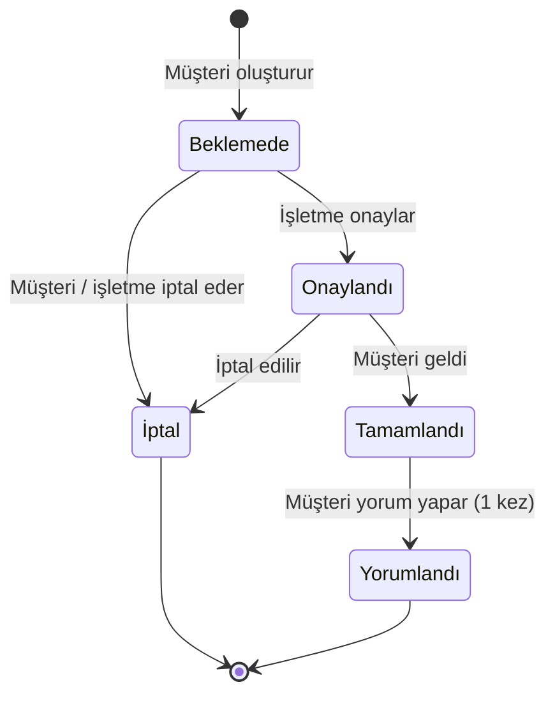
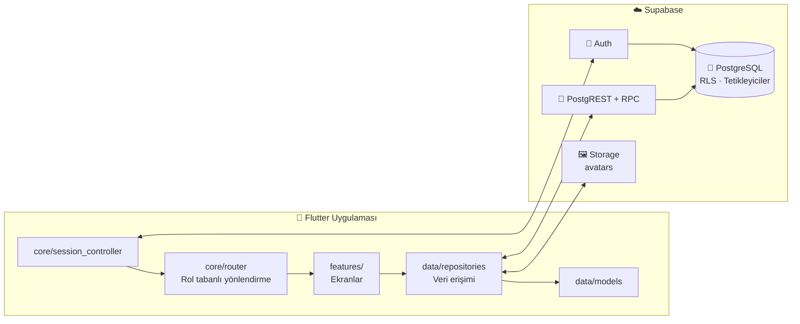
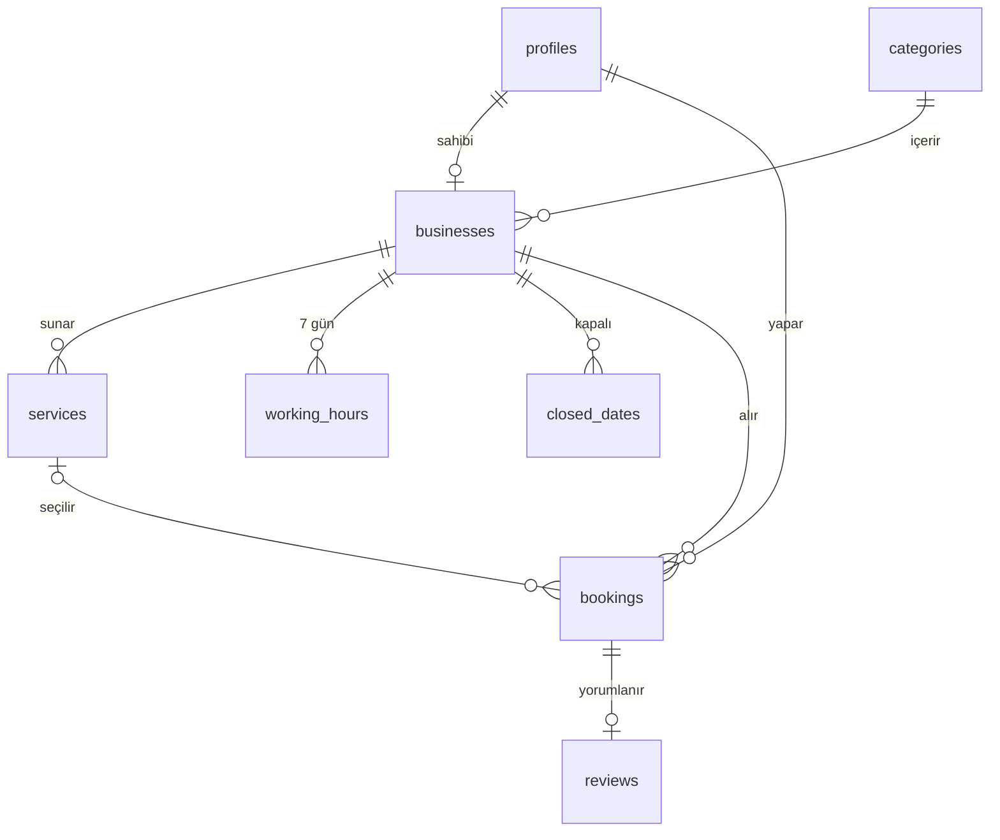

<div align="center">


# Ayırt

**Her türden işletme için tek uygulamada rezervasyon.**
Kuaförden restorana, spor salonundan diş kliniğine; müşteri arar, saatini seçer, *ayırtır*.


</div>

---

## 📌 Proje Hakkında

**Ayırt**, işletmelerin kendi rezervasyon sistemini kurmakla uğraşmadan hazır bir altyapıyı kullanabildiği, müşterilerin de tüm işletmeleri **tek bir uygulamadan** bulup rezervasyon yapabildiği üç rollü bir mobil uygulamadır.

Uygulama **esnek takvim modeli** sayesinde tek bir işletme türüne bağlı değildir:

| İşletme türü | Ayar örneği |
|---|---|
| 💇 Kuaför | 30 dk'lık aralık · aynı anda 1 müşteri |
| 🍽️ Restoran | 60 dk'lık aralık · aynı anda 40 kişi |
| 🏋️ Spor salonu | 60 dk'lık aralık · ders başına 15 kişi |
| 🦷 Klinik | 20 dk'lık aralık · aynı anda 1 hasta |

> Her işletme yalnızca **aralık süresi** (`slot_minutes`) ve **aralık başına kapasite** (`capacity_per_slot`) belirler; gerisini Ayırt halleder.

---

## ✨ Özellikler

<table>
<tr>
<th width="33%">👤 Müşteri</th>
<th width="33%">🏪 İşletme</th>
<th width="33%">🛠️ Admin</th>
</tr>
<tr valign="top">
<td>

- 🔍 İsme veya kategoriye göre işletme arama
- 🏷️ Kategori filtreleri
- ⭐ Puan ve yorumları görme
- 📅 Gün şeridinden tarih, listeden müsait saat seçme
- 👥 Kişi sayısı ve not ekleme
- 📋 Rezervasyonlarım (yaklaşan / geçmiş)
- ❌ Saati gelmemiş rezervasyonu iptal etme
- ✍️ Tamamlanan rezervasyona **tek seferlik** yorum
- 🖼️ Profil fotoğrafı

</td>
<td>

- 📥 Gelen rezervasyonları onaylama / reddetme
- ✅ Gelen müşteriyi "tamamlandı" yapma
- 🕘 Haftalık çalışma saatleri
- 🚫 Kapalı gün (tatil, bakım) ekleme
- ⏱️ Aralık süresi ve kapasite ayarı
- 💼 Hizmet ve fiyat listesi
- 🖼️ Logo, kapak, açıklama, adres
- 🗂️ Geçmiş rezervasyonlar
- ⚠️ Askıya alınınca uyarı bandı

</td>
<td>

- 📊 Dashboard: kullanıcı, işletme, rezervasyon sayıları
- 👥 Müşteri listesi ve arama
- 🏢 İşletme listesi, aktif/askıda durumu
- 🔎 Kişi veya işletme bazında rezervasyon geçmişi
- 🏷️ Kategori ekleme / düzenleme / silme
- 🎨 15 ikonluk kategori ikon seçici

</td>
</tr>
</table>

### 🔄 Rezervasyon Yaşam Döngüsü


---

### 🧰 Teknolojiler

| Katman | Kullanılan |
|---|---|
| Dil | Dart |
| Arayüz | Flutter · Material Design 3 (seed renk `#FF751F`) |
| Yönlendirme | `go_router` (rol tabanlı `redirect`) |
| Backend | Supabase (Auth · PostgREST · Storage) |
| Veritabanı | PostgreSQL (RLS, `security definer` fonksiyonlar, tetikleyiciler) |
| Diğer paketler | `supabase_flutter`, `intl`, `image_picker`, `flutter_localizations` |
| Geliştirme | Visual Studio Code · Android Studio (Emulator) |

---

## 🏗️ Mimari



---

### 📂 Klasör Yapısı

```text
ayirt/
├── 📁 lib/
│   ├── main.dart                 # Başlangıç: Supabase + tema + router
│   ├── 📁 core/                  # Config, tema, oturum, yönlendirme, biçimlendiriciler
│   ├── 📁 data/
│   │   ├── 📁 models/            # Profile, BusinessCard, Booking, Slot ...
│   │   └── 📁 repositories/      # Supabase sorguları ve RPC çağrıları
│   ├── 📁 features/
│   │   ├── 📁 auth/              # Giriş, kayıt
│   │   ├── 📁 customer/          # Keşfet, detay, rezervasyon, profil
│   │   ├── 📁 business/          # Plan, takvim, hizmetler, geçmiş
│   │   └── 📁 admin/             # Dashboard, listeler, kategori yönetimi
│   └── 📁 shared/                # Ortak widget'lar ve yardımcılar
├── 📁 supabase/
│   └── 001_schema.sql            # Tüm şema, RLS, fonksiyonlar, tetikleyiciler
├── 📁 assets/                    # logo.png
└── env.example.json              # Ortam değişkeni şablonu
```
---

## 🗄️ Veritabanı



| RPC fonksiyonu | Görevi |
|---|---|
| `get_available_slots(business, date)` | Çalışma saati, kapalı gün ve doluluğa göre müsait saatleri hesaplar |
| `create_booking(...)` | `pg_advisory_xact_lock` ile **çift rezervasyonu** engelleyerek kayıt açar |
| `update_booking_status(...)` | Role göre izin verilen durum geçişlerini uygular |
| `admin_stats()` | Dashboard sayılarını tek JSON olarak döner |

---

## 🔐 Güvenlik

- 🛡️ **Tüm tablolarda Row Level Security** açık; her kullanıcı yalnızca yetkili olduğu satırları görür.
- 🔒 Rezervasyon ekleme ve güncelleme **yalnızca RPC** üzerinden yapılır; istemci tabloya doğrudan yazamaz.
- 🧱 Tetikleyiciler kullanıcının kendi **rolünü**, işletmenin **aktiflik** durumunu ve **sahibini** değiştirmesini engeller.
- ⭐ Yorum yalnızca **kendi tamamlanmış** rezervasyonuna ve **bir kez** yapılabilir.
- 🔑 Uygulamada sadece **publishable key** bulunur. `env.json` `.gitignore`'dadır; `secret` anahtar hiçbir zaman istemciye konmaz.


---
## 🚀 Kurulum

### 1️⃣ Gereksinimler
- Flutter **3.35+** → `flutter --version`
- VS Code + **Flutter** ve **Dart** eklentileri
- Android Studio (SDK, Emulator ve NDK için) veya USB hata ayıklaması açık bir Android cihaz
- Ücretsiz bir [Supabase](https://supabase.com) hesabı

### 2️⃣ Supabase'i hazırla
1. **New project** oluştur.
2. **SQL Editor → New query** → `supabase/001_schema.sql` içeriğini yapıştır → **Run**.
3. Geliştirme için **Authentication → Providers → Email → Confirm email** seçeneğini kapat.
4. **Project Settings → API Keys** sayfasından **Project URL** ve **Publishable key** değerlerini kopyala.

### 3️⃣ Projeyi çalıştır

```bash
git clone https://github.com/<kullanici-adi>/ayirt.git
cd ayirt
flutter pub get
```

`env.example.json` dosyasını `env.json` adıyla kopyala ve doldur:

```json
{
  "SUPABASE_URL": "https://xxxx.supabase.co",
  "SUPABASE_KEY": "sb_publishable_..."
}
```

```bash
# Emülatör / cihaz
flutter run --dart-define-from-file=env.json

# Tarayıcı
flutter run -d edge --dart-define-from-file=env.json
```

> 💡 VS Code'da **F5** de yeterli; `.vscode/launch.json` `env.json`'u otomatik okur.

### 4️⃣ Admin hesabı oluştur
Normal bir hesapla kayıt ol, sonra SQL Editor'de:

```sql
update public.profiles set role = 'admin' where email = 'admin@ornek.com';
```

### 📦 APK oluşturma

```bash
flutter build apk --release --dart-define-from-file=env.json
# Çıktı: build/app/outputs/flutter-apk/app-release.apk
```

---